# 🤖 Awesome Multi-Agent Problem Solving 🌐

  <strong>A definitive curated directory of production SaaS platforms, cutting-edge open-source frameworks, and algorithmic orchestration patterns for multi-agent reasoning, recursive task decomposition, stigmergic coordination, and governed agent swarms.</strong>

  <em>Designed for AI research scientists, MLOps engineers, and distributed systems architects building self-correcting agent swarms.</em>

---

## 📑 Table of Contents
- [🧠 Overview & Architectural Thesis](#-overview--architectural-thesis)
- [📊 Sector Overview & Market Dynamics](#-sector-overview--market-dynamics)
- [🏢 Enterprise & SaaS Platforms](#-enterprise--saas-platforms)
- [💻 Open-Source GitHub Projects](#-open-source-github-projects)
- [🧩 Problem-Solving Architectural Patterns](#-problem-solving-architectural-patterns)
- [🛠️ How to Contribute](#️-how-to-contribute)
- [⚖️ Disclaimer](#️-disclaimer)
- [📈 Star History](#-star-history)
- [💖 Support & Sponsorship](#-support--sponsorship)

---

## 🧠 Overview & Architectural Thesis

Modern artificial intelligence is transitioning rapidly from monolithic, single-pass Large Language Model (LLM) prompting to **Multi-Agent Problem Solving (MAPS)** systems. Complex reasoning problems—such as multi-repository software development, continuous scientific hypothesis verification, financial auditing, and recursive logic resolution—suffer steep failure rates when delegated to an isolated model prompt.

Multi-agent architectures divide computational burdens into decentralized colonies:
1. **Recursive Decomposition**: High-level objectives are split into deterministic subtasks via meta-planner agents.
2. **Inner-Monologue & Dialectic Deliberation**: Adversarial or complementary agents critique, verify, and refine reasoning before exposing responses.
3. **Computational Stigmergy**: Decentralized swarms interact asynchronously through persistent state trails and decaying pheromones rather than rigid, brittle message networks.
4. **Governed Execution & Human-in-the-Loop**: Strict constitutional guardrails and checkpoint sandboxes ensure agent tools operate safely under enterprise constraints.

---

## 📊 Sector Overview & Market Dynamics

The global **Autonomous AI & Multi-Agent Systems market** is valued at approximately **$6.2B to $14.0B** and is projected to expand to **$127.8B to $471.5B by 2035**, compounding at an aggressive **CAGR of 40.2% to 43.8%**. 

From a competitive landscape perspective, the sector exhibits **moderate-to-high fragmentation** at the framework, runtime, and agent-orchestration layer, where rapid open-source innovation (graph-based engines, stigmergic colonies, role-playing agents) creates intense developer divergence. In contrast, foundational data curation, expert RLHF evaluation, and verification infrastructure demonstrate high **winner-take-all concentration**, with well-capitalized leaders capturing massive enterprise contracts from frontier model builders.

---

## 🏢 Enterprise & SaaS Platforms

The following hosted platforms provide enterprise agent swarms, managed human-in-the-loop validation, and production agent observability. Sorted descending by **Company Size (Valuation / ARR)**:

| 🏢 Platform | 💰 Company Size (Valuation / ARR) | 🎯 Primary Problem-Solving Focus | 🏷️ Specific Starting Pricing | 🎁 Free Tier Limit / Trial Duration |
| :--- | :--- | :--- | :--- | :--- |
| **[Surge AI](https://surgehq.ai)** | **$25.0B Valuation** (~$1.2B ARR, Bootstrapped) | High-throughput expert evaluation, complex multi-turn RLHF swarms & reasoning data verification | Starts at **$18.00–$24.00/hour** for baseline annotator tasks; scaling to **$50.00–$150.00/hour** for specialized STEM & coding domains | **14-day scoped pilot evaluation** with custom benchmark dataset allocation upon enterprise sales onboarding |
| **[Scale AI](https://scale.com)** | **$13.8B Valuation** (~$750M ARR) | Enterprise data engine, multi-agent reinforcement learning environments & model safety evaluation | Self-serve pay-as-you-go starts at **$0.05 per labeling unit**; custom enterprise contracts start at **$50,000/year** | **Free Forever Rapid Tier**: 1,000 labeling units and 10,000 image units at zero cost |
| **[Snorkel AI](https://snorkel.ai)** | **$3.5B Valuation** (~$350M ARR) | Snorkel Flow programmatic supervision, weak supervision swarms & programmatic labeling pipelines | Software deployments start at **$50,000/year** ($4,166.67/month billed annually via AWS Marketplace) | **30-day proof-of-concept pilot** with custom data assessment and targeted evaluation sandbox |
| **[Cognition AI](https://cognition.ai)** | **$2.0B Valuation** (Series B) | Autonomous multi-agent software engineering (Devin) with sandboxed planning, execution, and terminal verification | Team plan starts at **$500/month** (includes 250 agent compute units / ACUs; $2.00/ACU thereafter) | **14-day gated trial** with 10 free agent execution run credits upon onboarding approval |
| **[Labelbox](https://labelbox.com)** | **$1.3B Valuation** (~$100M ARR) | Multimodal data curation, RLHF workflow pipelines, model error analysis & human-in-the-loop consensus | Pay-as-you-go starts at **$0.10 per Labelbox Unit (LBU)**; Starter package tiers start at **$850/month** | **Free Forever Plan**: 500 Labelbox Units (LBUs)/month, up to 30 active user seats, and core annotation tooling |
| **[LangChain (LangSmith / LangGraph Cloud)](https://langchain.com)** | **$250M Valuation** (Series A) | Cyclical state-graph agent orchestration, multi-agent tracing, and deterministic checkpoint debugging | Developer Plus tier starts at **$39/seat/month**; LangGraph Cloud execution starts at **$0.002/agent invocation second** | **Free Forever Developer Tier**: 5,000 traces/month, 1 user seat, and 14 days of telemetry log retention |
| **[CrewAI (Enterprise Cloud)](https://crewai.com)** | **$100M+ Valuation** (Series A) | Production-grade multi-agent collaboration, autonomous role delegation, and governed agent crew execution | Starter tier starts at **$25/month**; CrewAI AMP Enterprise tiers start at **$500/month** | **Free Forever Plan**: 500 execution credits/month, up to 5 hosted automated agent workflows, and community support |

---

## 💻 Open-Source GitHub Projects

Curated open-source repositories and runtime frameworks for constructing multi-agent problem-solving systems. Sorted descending by **GitHub Star Count**:

### 1. 🤖 [AutoGPT](https://github.com/Significant-Gravitas/AutoGPT) 
- **Architecture**: Autonomous agent ecosystem featuring the Classic CLI agent, Agent Protocol compliance, and the visual AutoGPT Builder.
- **Problem-Solving Paradigm**: Chains recursive goal decomposition, autonomous tool creation, web surfing, and file mutation into an open-ended execution loop.
- **License**: MIT

### 2. 🚀 [Dify](https://github.com/langgenius/dify) 
- **Architecture**: Production-ready LLM application development platform featuring a visual multi-agent workflow orchestrator, RAG pipelines, and model evaluation.
- **Problem-Solving Paradigm**: Graph-based node execution connecting prompt engineers, autonomous sub-agents, tool integrations, and human intervention points.
- **License**: Apache 2.0

### 3. 👐 [OpenHands](https://github.com/All-Hands-AI/OpenHands) 
- **Architecture**: Open-source autonomous AI software developer (formerly OpenDevin) capable of executing terminal bash commands, editing code, and browsing documentation.
- **Problem-Solving Paradigm**: Event-driven agent-environment interaction loop equipped with sandboxed Docker runtime verification and unit-test validation.
- **License**: MIT

### 4. 🎭 [MetaGPT](https://github.com/geekan/MetaGPT) 
- **Architecture**: Multi-agent collaborative framework that encodes human Standard Operating Procedures (SOPs) into specialized LLM agent personas.
- **Problem-Solving Paradigm**: Simulates an entire software company (Product Managers, Architects, Project Managers, Engineers, QA) that outputs PRDs, UML diagrams, and verified codebases.
- **License**: MIT

### 5. 👥 [AutoGen](https://github.com/microsoft/autogen) 
- **Architecture**: Multi-agent conversational orchestration platform enabling customizable, conversable agents that integrate LLMs, tools, and human feedback.
- **Problem-Solving Paradigm**: Dynamic multi-agent dialogue patterns including nested chats, round-robin consensus, group chats with selector agents, and code execution sandboxes.
- **License**: MIT

### 6. 🦾 [CrewAI](https://github.com/crewAIInc/crewAI) 
- **Architecture**: Role-based agent orchestration framework designed for structured engineering of autonomous swarms.
- **Problem-Solving Paradigm**: Decomposes enterprise tasks across collaborative crews where agents possess explicit roles, backstories, memory caches, and inter-agent delegation protocols.
- **License**: MIT

### 7. 🕸️ [LangGraph](https://github.com/langchain-ai/langgraph) 
- **Architecture**: Low-level orchestration library that models agent workflows as cyclical state graphs with first-class time-travel and persistence.
- **Problem-Solving Paradigm**: Explicit cyclical coordination with fine-grained state manipulation, conditional edge branching, deterministic subgraphs, and human-in-the-loop breakpoints.
- **License**: MIT

### 8. 💻 [ChatDev](https://github.com/OpenBMB/ChatDev) 
- **Architecture**: Virtual software development company operated by multi-agent role-playing dialogic systems.
- **Problem-Solving Paradigm**: Employs an incremental ChatChain phase model (designing, coding, testing, documenting) where agent pairs resolve ambiguities through communicative de-hallucination.
- **License**: Apache 2.0

### 9. 🔭 [AgentScope](https://github.com/modelscope/agentscope) 
- **Architecture**: Developer-centric multi-agent platform developed by Alibaba Damo Academy featuring message exchange primitives, customizable pipelines, and agent distribution.
- **Problem-Solving Paradigm**: Python-native actor-style message passing with structured prompt engineering, automated retry policies, and synthetic simulation testing.
- **License**: Apache 2.0

### 10. 🔬 [GPT Researcher](https://github.com/assafelovic/gpt-researcher) 
- **Architecture**: Autonomous agent dedicated to comprehensive online research across 20+ web sources per task.
- **Problem-Solving Paradigm**: Planner agent produces sub-inquiry tasks; multiple parallel scraping/filtering worker agents gather citations; aggregator synthesizes objective, auditable reports.
- **License**: Apache 2.0

### 11. 🐫 [CAMEL](https://github.com/camel-ai/camel) 
- **Architecture**: Communicative Agents for "Mind" Exploration in multi-agent socio-behavioral simulations.
- **Problem-Solving Paradigm**: Inception prompting technique where an AI user agent and AI assistant agent conduct self-directed dialogue to solve complex collaborative objectives without human guidance.
- **License**: Apache 2.0

### 12. ⚡ [SuperAGI](https://github.com/TransformerOptimus/SuperAGI) 
- **Architecture**: Open-source autonomous AI agent framework with GUI, agent telemetry console, action consoles, and vector DB connectors.
- **Problem-Solving Paradigm**: Concurrent multi-agent execution loops with fine-grained resource and budget limits, multi-model support, and tool marketplace integration.
- **License**: MIT

### 13. 🏛️ [ROMA](https://github.com/sentient-agi/ROMA) 
- **Architecture**: Recursive Meta-Agent framework built by Sentient AGI for hierarchical task decomposition.
- **Problem-Solving Paradigm**: Four-stage recursive cycle: **Atomizer** (determines task granularity), **Planner** (partitions tasks), **Executor** (carries out atomic routines), and **Aggregator** (compiles outputs back up the tree).
- **License**: MIT

### 14. 🌐 [AgentVerse](https://github.com/OpenBMB/AgentVerse) 
- **Architecture**: Simulation and task-solving platform for assembling multi-agent environments from OpenBMB.
- **Problem-Solving Paradigm**: Configurable multi-agent simulation environments enabling agents to negotiate, collaborate in teams, or solve specialized reasoning benchmarks under explicit rules.
- **License**: Apache 2.0

### 15. 🧠 [SocietyOfMindAgent (AG2)](https://github.com/ag2ai/ag2) 
- **Architecture**: Advanced inner-monologue design pattern that encapsulates a full internal multi-agent group chat behind a single external agent interface.
- **Problem-Solving Paradigm**: External orchestrators interact with a single agent; internally, an AssistantAgent and code-executing UserProxy debate across multiple rounds before a response preparer distills the final consensus.
- **License**: Apache 2.0

### 16. 🐜 [Ormica](https://github.com/Ranzim/ormica) 
- **Architecture**: Computational stigmergy agent colony framework treating problem-solving as emergent coordination.
- **Problem-Solving Paradigm**: Four pillars: **Arbor** (emergent hierarchy), **Stigma + Mycelium** (pheromone field coordination), **Canopy** (permission chain gates), and **Cortex** (constitutional governance kernel).
- **License**: Apache 2.0

---

## 🧩 Problem-Solving Architectural Patterns

When architecting a production multi-agent system, selecting the correct coordination pattern is critical:

```mermaid
flowchart TD
    subgraph Stigmergic["1. Computational Stigmergy (Decentralized Swarms)"]
        Goal[Objective Seed] --> Field[(Shared Pheromone Field)]
        Field --> AgentA[Agent A]
        Field --> AgentB[Agent B]
        AgentA -->|Deposit Signal| Field
        AgentB -->|Prune / Decay| Field
    end

    subgraph Recursive["2. Recursive Meta-Agent Loop (ROMA)"]
        InputTask[Complex Input] --> Atomizer{Atomizer: Is Task Atomic?}
        Atomizer -->|Yes| DirectExec[Atomic Executor]
        Atomizer -->|No| Planner[Meta Planner]
        Planner --> Sub1[Subtask 1]
        Planner --> Sub2[Subtask 2]
        Sub1 --> DirectExec
        Sub2 --> DirectExec
        DirectExec --> Aggregator[Aggregator]
        Aggregator --> FinalResult[Synthesized Result]
    end

    subgraph InnerMonologue["3. Society of Mind (Inner Monologue Pattern)"]
        UserReq[User Request] --> OuterAgent[SocietyOfMind Agent]
        subgraph InternalChat["Hidden Inner Monologue"]
            Worker[Worker Agent] <--> Critic[Verifier / Critic Agent]
        end
        OuterAgent --> InternalChat
        InternalChat --> ResponsePreparer[Response Filter]
        ResponsePreparer --> FinalAnswer[Clean Output]
    end
```

---

## 🛠️ How to Contribute

We welcome additions and updates from the open-source and enterprise AI community!

1. **Fork the Repository**: Click `Fork` on GitHub.
2. **Create a Feature Branch**: `git checkout -b feature/add-new-framework`.
3. **Add Entry**: Ensure you follow the established tabular or list formatting:
   - For SaaS: Include specific starting tier pricing, free tier/trial limits, and company size.
   - For Open-Source: Include star badge formatted with `style=social&color=white`, GitHub link to stargazers, architecture summary, and license.
4. **Submit a Pull Request**: Provide a clear explanation of the project's multi-agent problem-solving capabilities.

---

## ⚖️ Disclaimer

- This repository is a **community-curated index** provided for educational and architectural research purposes. Listings do not constitute endorsements.
- Multi-agent systems introduce real-world coordination overhead, token latency, and recursion traps. A well-prompted monolithic model often outperforms an unconstrained, poorly-orchestrated committee.
- Always implement budget caps, loop counters, and sandboxed runtimes when deploying autonomous agents with execution privileges.

---

## 📈 Star History

---

## 💖 Support & Sponsorship

If you found this curated multi-agent ecosystem guide valuable for your research, team, or projects, please consider supporting the project:

- ⭐ **Star this repository** to help others discover it!
- 🍴 **Fork and contribute** to keep entries accurate and up to date.
- 📢 **Share with your colleagues** on LinkedIn, X, or Discord communities.
- ☕ **Sponsor the Maintainer**: Support ongoing curation, benchmark analyses, and open-source tooling via the [GitHub Sponsor Dashboard](https://github.com/sponsors/ishandutta2007).

  

